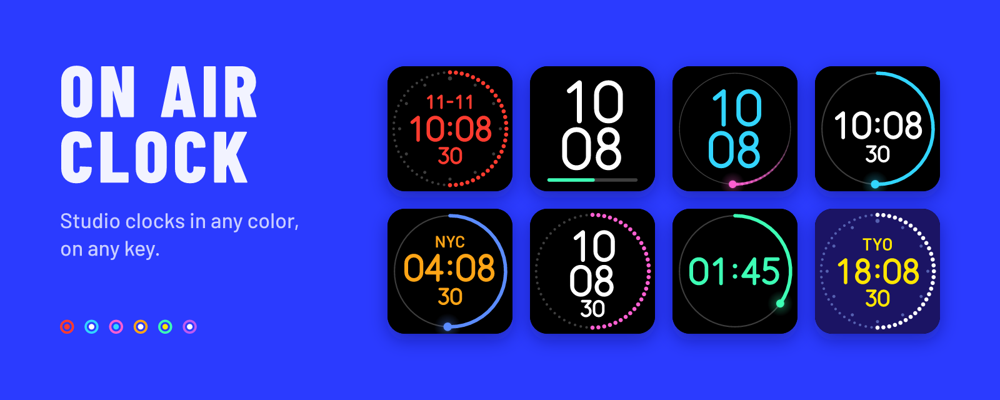
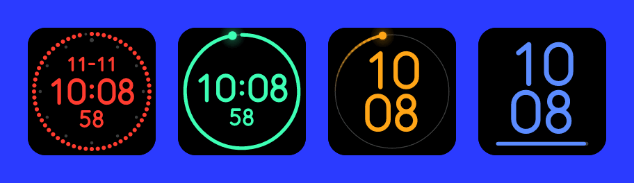

# On Air Clock

**Studio clocks in any color, on any key.**

A broadcast studio clock for your Stream Deck: five watchfaces, any color, time zones and a countdown.



## Features

- **Five watchfaces.**
  - **Classic**: the on air clock with 60 dots, hour marks, and optional date and seconds.
  - **Modern Minimal**: reduced and quiet.
  - **Line**: a continuous arc with a glowing head.
  - **Comet**: a light point with a fading tail circles a hairline ring.
  - **Big**: hours and minutes as large as the key allows, readable from across the room.
- **Any color.** Set the active color, the inactive color and the background freely.
- **Time zones per key.** Use the system time, pick an IANA time zone, or set a fixed UTC offset (-12:00 to +14:00 in 15-minute steps). An optional short label (up to 6 characters, e.g. `NYC`) tells your world clocks apart.
- **Countdown.** A separate Countdown action starts a preset duration of up to 99:59 on all clocks of the same Stream Deck that have "Show countdown" enabled. Press the Countdown key again, or press a clock, to cancel. When the countdown reaches zero you choose what happens:
  - **Count overtime** (default): keeps counting as `+MM:SS`.
  - **Hold at 00:00**: stays at zero and blinks until you cancel.
  - **Back to clock**: flashes briefly, then shows the time again.

  An optional warning pulse marks the last 10 seconds.
- **Subtle animations**, all on by default: rolling digits, ring reset at the full minute, blinking colon and an afterglow on the current second. Each can be switched off.
- **Date and time formats.** Five date formats, 12 or 24 hour display and an optional PM indicator.
- **Stream Deck+ touch display** supported.

## Installation

Requires Stream Deck software 7.1 or newer, on macOS 12+ or Windows 10+. If you stay on an older Stream Deck version, you keep On Air Clock V1.

### From the Elgato Marketplace

Search for "On Air Clock" in the Stream Deck Marketplace and click Install.

### From a GitHub release

Download `fail.marc.onairclock.streamDeckPlugin` from the [releases section](../../releases) and open it. The Stream Deck software installs it.

### Updating from V1

V2 keeps the plugin ID, so existing keys stay in place and keep their settings. Keys that never had settings changed pick up the V2 defaults. The look of the clock is refreshed (new digits, new details).

## Wrong time?

On Air Clock takes time zone data from the Node.js runtime that Stream Deck provides. If that runtime ships outdated time zone data, a time zone can be off by an hour after a recent rule change. A known example: British Columbia's switch to permanent UTC-7 can show as UTC-8 (see issue #10).

Observed in local Node v24 (tzdata 2025c): `America/Vancouver` reports UTC-08:00 on 2026-11-11. This is what the development machine measured, and the Stream Deck runtime may differ.

**Fix:** open the key settings, set "Time zone" to "Fixed UTC offset" and choose the correct offset, for example -07:00. This works without waiting for any update. Keep in mind that a fixed offset does not follow daylight saving changes by itself.

## Development

```sh
npm ci
npm test
npm run build:dev
npx streamdeck link build/fail.marc.onairclock.dev.sdPlugin
npx streamdeck restart fail.marc.onairclock.dev
```

`npm run build:dev` builds the dev variant `fail.marc.onairclock.dev` into `build/`. It runs next to an installed release version and does not touch its profiles.

### Release

Pushing the tag `v2.0.0` starts the release workflow. It creates a draft GitHub release with the packed plugin attached.

## Disclaimer

I made this plugin just for fun and because I thought it would be handy to have a plugin like that. Therefore, it is released under the MIT license. Do whatever you want with it, but it comes without warranty or liability of any kind.

However, an acknowledgement would be nice.

## Feature and pull requests

Feel free to request features, but my time is very limited. If you want to contribute, create a PR. I will review it and merge it if it makes the plugin better.

## License

MIT. See [LICENSE](LICENSE). Copyright (c) Marc Herrmann.

## Acknowledgements

- Stream Deck+ support: thanks to Wolfgang Dworzak (#6).
- Date format option order: thanks to Takumi Saito (#9).
- V1 was based on the [Elgato plugin template](https://github.com/elgatosf/streamdeck-plugintemplate). The clock calculation and drawing routine was inspired by [this kirupa tutorial](https://www.kirupa.com/html5/create_an_analog_clock_using_the_canvas.htm).
- V2 is built on the official [Stream Deck SDK](https://docs.elgato.com/streamdeck/sdk/introduction/getting-started) and the Elgato CLI.
